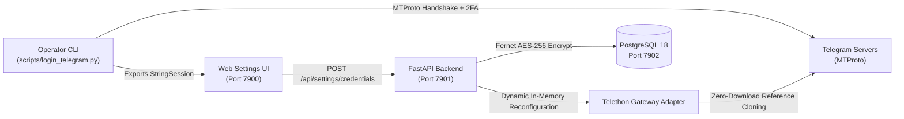

# Telegram MTProto Real Account Authentication Guide

Connect a real Telegram account to Telegram Video Migrator (Telegram Hub) using Telethon MTProto, `StringSession`, and AES-256 encrypted storage.

---

## ⚡ Quick Path (TL;DR)

1. **Obtain Telegram API Credentials**:
   - Navigate to [my.telegram.org](https://my.telegram.org) and log in with your phone number.
   - Go to **API development tools**, create an app (e.g. `TelegramMigrator`), and copy `api_id` and `api_hash`.

2. **Generate Session String (Interactive CLI)**:
   ```bash
   python3 scripts/login_telegram.py
   ```
   - Enter your `API ID` and `API HASH`.
   - Enter your phone number with country code (e.g. `+5491112345678`).
   - Enter the login code received in Telegram (and your 2FA password if enabled).
   - Copy the generated `TELEGRAM_SESSION_STRING`.

3. **Activate Credentials in Web UI**:
   - Open [http://localhost:7900/settings](http://localhost:7900/settings).
   - In the **Telegram Credentials** tab, enter your `API ID`, `API HASH`, and paste the `Session String`.
   - Click **Save & Activate**. Credentials are encrypted with AES-256 at rest in PostgreSQL and hot-swapped in the backend without restarting Docker containers.

4. **Verify Connection**:
   - Go to [http://localhost:7900/migration](http://localhost:7900/migration) or [http://localhost:7900/chats](http://localhost:7900/chats) to confirm channels and live dialogs are listed.

---

## 🏗️ Architecture & Security Model



### Why StringSession?
In modern containerized deployments (Docker Compose / Kubernetes), running interactive CLI prompts inside headless containers for SMS/Telegram verification codes causes runtime stalls. A `StringSession` encapsulates the authorized MTProto authorization key into a portable Base64 string that can be loaded headlessly in production without user interaction.

### Security Guarantees
- **Encrypted at Rest**: Credentials (`api_id`, `api_hash`, `session_string`) are encrypted using Fernet (AES-128-CBC with SHA256 HMAC authentication) before storage in PostgreSQL.
- **Never Returned in Cleartext**: The API endpoints (`GET /api/settings/credentials`) only return masked identifiers (e.g. `api_hash: **********`).
- **Dynamic Hot-Swapping**: When credentials are saved or updated, the backend client factory re-instantiates the active Telethon gateway in memory immediately; no container rebuild or restart required.

---

## 🛠️ Step-by-Step Instructions

### Step 1: Obtain `api_id` and `api_hash`

1. Open [https://my.telegram.org](https://my.telegram.org).
2. Enter your mobile phone number including international country code.
3. Enter the confirmation code sent to your Telegram client.
4. Select **API development tools**.
5. Fill out the application form:
   - **App title**: `Telegram Video Migrator`
   - **Short name**: `tgmigrator`
   - **Platform**: `Desktop` or `Web`
6. Click **Create application**.
7. Note down your `App api_id` (numeric integer) and `App api_hash` (hexadecimal string).

### Step 2: Run Login Assistant

Run the CLI script from the root of the repository:

```bash
# Ensure Python 3.10+ and requirements are installed locally
python3 scripts/login_telegram.py
```

The script will guide you interactively:
```text
=================================================================
  🚀 TELEGRAM VIDEO MIGRATOR · ASISTENTE DE CONEXIÓN REAL MTPROTO
=================================================================

Ingresá tu API ID (numérico): 12345678
Ingresá tu API HASH (hexadecimal): 0123456789abcdef0123456789abcdef

Ingresá tu número de teléfono con código de país (ej: +5491112345678): +5491112345678

Iniciando conexión con los servidores de Telegram...
Enviando código de verificación a Telegram (+5491112345678)...
Ingresá el código numérico recibido en tu app de Telegram: 54321

=================================================================
  ✅ ¡AUTENTICACIÓN EXITOSA CON TELEGRAM!
=================================================================
  Usuario:   John Doe (@johndoe)
  ID:        987654321
  Teléfono:  +5491112345678
=================================================================

Tu TELEGRAM_SESSION_STRING es:
1BVtsOHQBu...[truncated]...=
```

### Step 3: Choose Storage Method

You have two complementary options to persist credentials:

#### Option A: Web UI & PostgreSQL (Recommended)
1. Log in to the application at `http://localhost:7900` as an `ADMIN`.
2. Go to **Settings** (`/settings`) → **Telegram Credentials**.
3. Fill in:
   - **Account Name**: e.g., `Production Bot / Personal Account`
   - **API ID**: `12345678`
   - **API Hash**: `0123456789abcdef0123456789abcdef`
   - **Session String**: `1BVtsOHQBu...=`
4. Check **Set as Active Account** and click **Save Credentials**.
5. The backend instantly decrypts and binds this account for all subsequent migration requests.

#### Option B: Local `.env` File (Development fallback)
The script allows automatically appending the credentials to your local `.env`:
```bash
¿Deseas guardar automáticamente esta sesión en tu archivo .env local? (s/N): s
  ✓ Guardado en .env exitosamente.
```
Variables stored:
```ini
TELEGRAM_API_ID=12345678
TELEGRAM_API_HASH=0123456789abcdef0123456789abcdef
TELEGRAM_SESSION_STRING=1BVtsOHQBu...=
```

---

## 🔍 Verification & Diagnostics

| Screen / Endpoint | Expected State | What to check |
|-------------------|----------------|---------------|
| `http://localhost:7900/migration` | Source and Target dropdowns populated | Channel titles and permission badges (`can_post`) visible. |
| `http://localhost:7900/chats` | Chat history and dialogs list | Direct messages, channels, and supergroups appear with live badges. |
| `GET /api/channels` | HTTP `200 OK` | JSON array containing `{ id, title, username, can_post }`. |
| `GET /api/telegram/dialogs` | HTTP `200 OK` | JSON array containing real MTProto dialog entities. |

---

## ⚠️ Troubleshooting & Gotchas

- **`SessionPasswordNeededError`**:
  If you have Two-Factor Authentication (2FA) enabled on your Telegram account, the script will prompt for your cloud password using secure terminal input (`getpass`).
- **`FloodWaitError`**:
  Telegram limits login attempts. If you request too many SMS codes within a few minutes, Telegram enforces a waiting period (typically 300 to 86400 seconds). Wait for the cooldown to expire.
- **Docker Network Isolation**:
  The backend container communicates with Telegram MTProto over ports 443/80 outbound. Ensure your host machine's firewall does not block outbound UDP/TCP connections to Telegram DC IP ranges (e.g., `149.154.167.0/24`, `91.108.56.0/22`).
